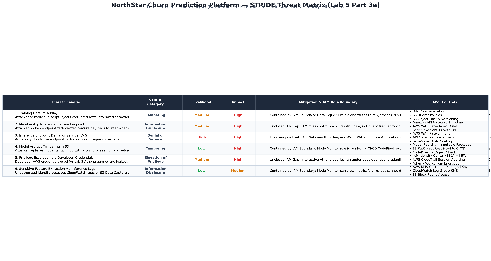
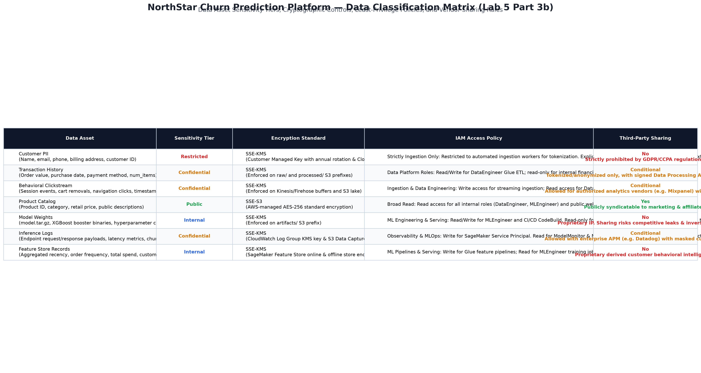

# Lab 5: Security Assessment — NorthStar Churn Prediction Platform

## 3a. STRIDE Threat Model

The STRIDE model is applied across the NorthStar customer churn prediction lifecycle: from data ingestion and feature engineering to model training, registry management, and real-time SageMaker endpoint inference.

### Visual Diagram: STRIDE Threat Matrix


### Existing Least-Privilege IAM Boundaries (Lab 2 Baseline):
- **`DataEngineer` Role:** Scope limited to AWS Glue crawlers, ETL jobs, and S3 data prefixes (`raw/`, `processed/`). No access to SageMaker model registry or training jobs.
- **`MLEngineer` Role:** Scope limited to SageMaker training, endpoint serving, `features/`, and `artifacts/` S3 prefixes. No access to Glue or Athena direct query execution.
- **`ModelMonitor` Role:** Scope limited to CloudWatch metrics, alarms, and read-only access to model artifacts. Cannot deploy models or modify datasets.

---

### STRIDE Threat Matrix Table

| Threat | STRIDE Category | Likelihood | Impact | Mitigation | AWS Control |
| :--- | :--- | :--- | :--- | :--- | :--- |
| **1. Training Data Poisoning**<br>Attacker or malicious script injects corrupted rows into raw transactions to distort churn boundaries and blind the model to churning customers. | **Tampering** | Medium | High | **Contained by IAM Role Boundary:** The `DataEngineer` role is strictly required to modify data in `raw/` or `processed/`. The `MLEngineer` role has zero write access to upstream data prefixes, preventing an ML script from tampering with baseline training data. S3 Object Lock and bucket versioning ensure data immutability. | - IAM Role separation (`DataEngineer` vs `MLEngineer`)<br>- S3 Bucket Policy (Restricting S3 PutObject)<br>- S3 Object Versioning & S3 Object Lock |
| **2. Membership Inference via Live Endpoint**<br>Attacker queries the endpoint with crafted feature payloads to mathematically infer whether specific customers were in the training set based on output confidence scores. | **Information Disclosure** | Medium | High | **Unclosed IAM Role Gap:** The Lab 2 IAM roles govern AWS infrastructure access, but **do not** restrict inference query volume or inspect payload contents once an application is granted `sagemaker:InvokeEndpoint`. Mitigation requires an API Gateway rate limiter, WAF anomaly filtering, and rounding/binning confidence scores rather than returning high-precision raw probabilities. | - Amazon API Gateway with Usage Plans & Throttling<br>- AWS WAF Rate-Based Rules<br>- SageMaker VPC PrivateLink Endpoint (No public exposure) |
| **3. Inference Endpoint Denial of Service (DoS)**<br>Adversary floods the real-time SageMaker endpoint with high concurrency, overwhelming `ml.t2.medium` / `ml.m5.large` instances and exceeding the 200ms latency threshold. | **Denial of Service** | High | High | Front the SageMaker endpoint with API Gateway request throttling and web application firewalls. Configure Application Auto Scaling with target tracking on SageMaker variant invocations, and set CloudWatch alarms to isolate degraded variants. | - AWS WAF (Rate-limiting rules)<br>- Amazon API Gateway Throttling<br>- SageMaker Application Auto Scaling (`TargetTrackingScalingPolicy`) |
| **4. Model Artifact Tampering in S3**<br>Attacker replaces the approved `model.tar.gz` in S3 with a compromised or backdoored model binary before deployment. | **Tampering** | Low | High | **Contained by IAM Role Boundary:** The `ModelMonitor` role is strictly read-only, and operational accounts cannot overwrite approved artifacts. Production deployment in CodePipeline strictly validates the SHA-256 digest of the model against the SageMaker Model Registry package ARN before staging. | - SageMaker Model Registry immutable versioning<br>- S3 Bucket Policy enforcing SSE-KMS and restricting PutObject to CI/CD role<br>- CodePipeline cryptographic hash verification |
| **5. Privilege Escalation via Developer Athena Credentials**<br>Developer AWS credentials used for interactive Lab 3 Athena queries are leaked, allowing direct data exfiltration bypassing service roles. | **Elevation of Privilege** | Medium | High | **Unclosed IAM Role Gap:** Interactive Athena queries ran under developer user credentials (`401R-Admin-su`) rather than an isolated service role, bypassing the `DataEngineer`/`MLEngineer` separation. Mitigation requires deprecating long-lived access keys, enforcing MFA, and migrating all interactive exploration to role-assumed IAM Identity Center temporary sessions. | - AWS IAM Identity Center (SSO) with MFA<br>- AWS CloudTrail interactive session monitoring<br>- Athena Workgroup encryption & enforced S3 output scoping |
| **6. Sensitive Feature Extraction via Inference Logs**<br>Unauthorized identity accesses CloudWatch Log streams or S3 Data Capture buckets containing logged customer feature vectors and churn scores. | **Information Disclosure** | Low | Medium | **Contained by IAM Role Boundary:** The `ModelMonitor` role can view alarms and aggregate metrics but lacks permission to decrypt underlying S3 payloads or alter KMS policies. All CloudWatch Log Groups and SageMaker Data Capture S3 buckets are encrypted using customer-managed KMS keys. | - AWS KMS Customer Managed Keys (CMK) with strict Key Policies<br>- CloudWatch Logs encryption (`kms:GenerateDataKey`)<br>- S3 Block Public Access & bucket policies |

---

## 3b. Data Classification

All NorthStar data assets are classified according to sensitivity tier, required cryptographic controls, IAM access boundaries, and third-party vendor sharing policies.

### Visual Diagram: Data Classification Matrix


### Data Classification Table

| Data Asset | Sensitivity Tier | Encryption Standard | IAM Access Policy | Third-Party Vendor Sharing? |
| :--- | :--- | :--- | :--- | :--- |
| **Customer PII**<br>(Name, email, phone, billing address, customer ID) | **Restricted** | **SSE-KMS**<br>(Customer Managed Key with yearly key rotation and CloudTrail audit logging) | **Strictly Ingestion Only:** Restricted to automated ingestion workers during tokenization. Explicit `Deny` for `MLEngineer`, `ModelMonitor`, and all public principals. PII is stripped prior to training. | **No.** Strictly prohibited by policy and regulatory standards (GDPR/CCPA). |
| **Transaction History**<br>(Order value, purchase date, payment method, num_items) | **Confidential** | **SSE-KMS**<br>(Enforced on `raw/` and `processed/` S3 prefixes) | **Data Platform Roles:** Read/Write access granted to `DataEngineer` role for Glue transformations. Read-only for internal financial auditing roles. Denied to `ModelMonitor`. | **Conditional.** Permitted only if tokenized/anonymized, stripped of direct customer IDs, and governed by a signed DPA (Data Processing Agreement). |
| **Behavioral Clickstream**<br>(Session events, page interactions, cart removals, timestamps) | **Confidential** | **SSE-KMS**<br>(Enforced on real-time streaming buffers and raw S3 lake) | **Ingestion & Data Engineering:** Write access granted to streaming ingestion role (Kinesis/Firehose); Read access granted to `DataEngineer` ETL pipelines. | **Conditional.** Permitted for authorized third-party analytics vendors (e.g., Mixpanel/Datadog) provided IP addresses and user agents are masked. |
| **Product Catalog**<br>(Product ID, category, retail price, public descriptions) | **Public** | **SSE-S3**<br>(AWS-managed AES-256 standard encryption) | **Broad Internal & External Read:** Read access granted to all internal service roles (`DataEngineer`, `MLEngineer`, web services) and public CDN caching layers. | **Yes.** Publicly distributable to affiliate networks, search crawlers, and retail marketing partners. |
| **Model Weights**<br>(`model.tar.gz`, XGBoost booster binaries, feature mappings) | **Internal** | **SSE-KMS**<br>(Enforced on `artifacts/` S3 prefix) | **ML Engineering & Inference:** Read/Write granted to `MLEngineer` training pipelines and CI/CD CodeBuild. Read-only granted to SageMaker Endpoint execution role. Denied to `DataEngineer`. | **No.** Proprietary intellectual property. Sharing model weights risks competitive exposure and model inversion attacks. |
| **Inference Logs**<br>(Endpoint request/response payloads, latency metrics, predictions) | **Confidential** | **SSE-KMS**<br>(CloudWatch Log Group KMS encryption & S3 Data Capture KMS) | **Observability & MLOps:** Write access restricted to SageMaker Service Principal (`sagemaker.amazonaws.com`). Read access granted to `ModelMonitor` and `MLEngineer` for operational triage. | **Conditional.** Permitted only with enterprise observability platforms (e.g., Datadog) under strict agreements, with customer feature fields masked or hashed. |
| **Feature Store Records**<br>(Aggregated recency, order frequency, average spend, tenure) | **Internal** | **SSE-KMS**<br>(SageMaker Feature Store online and offline storage encryption) | **ML Pipelines & Serving:** Write access granted to Glue transformation job; Read access granted to `MLEngineer` training jobs and real-time endpoint execution role. | **No.** Derived business intelligence and proprietary behavioural features representing company-specific customer scoring models. |

---

## 3c. Privacy Impact Assessment (PIA) — Customer Churn Prediction

### 1. Personal Data Inventory
Under GDPR Article 4(1), personal data includes any information relating to an identified or identifiable natural person. Pseudonymous identifiers (such as `customer_id` and `transaction_id`) remain personal data because they can be linked back to individual customers.

| Pipeline Stage | Personal Data Processed | Purpose of Processing | Storage & Compute Location |
| :--- | :--- | :--- | :--- |
| **Ingestion (Raw Data)** | `customer_id`, `transaction_id`, `purchase_date`, `order_value`, `num_items`, `payment_method`, `channel`, `store_id`, `product_category`. Direct PII (names, billing addresses, emails) is quarantined/excluded at the API boundary before ingestion. | Landing raw transactional records from point-of-sale and online channels. | S3 bucket (`raw/customers/`) encrypted with SSE-KMS. |
| **Transformation & Feature Engineering** | `customer_id`, aggregate purchase counts, total monetary spend, recency (days since last transaction), average order value, preferred payment method, channel affinity. | Transforming individual transaction events into customer-level analytical features. | AWS Glue ETL jobs, writing Parquet datasets to S3 (`processed/customers/`). |
| **Feature Store** | `customer_id` (Record Identifier), recency, frequency, spend aggregates, historical churn labels, event timestamps. | Low-latency feature serving for real-time inference and reproducible training dataset generation. | SageMaker Feature Store (online cache in memory and offline storage in S3). |
| **Model Training** | Feature vectors: recency, order frequency, monetary value, tenure, and binary target label (`churn`). **Note:** `customer_id` is explicitly stripped prior to model fitting. | Training and validating the XGBoost supervised classification model. | SageMaker Training Jobs / MLflow tracking (`artifacts/` S3 prefix). |
| **Real-Time Serving & Inference** | `customer_id` (passed as request metadata/header), real-time feature vector, and model output (churn probability score: 0.0 to 1.0). | Calculating instantaneous churn probability during customer interactions (e.g. cancellation flow). | SageMaker Endpoint (`northstar-churn-prod`) hosted on AWS instances. |
| **Observability & Logging** | Request timestamps, inference input payload features, predicted churn scores, model latency timings. | Operational monitoring, latency tracking, and data drift detection. | CloudWatch Log Groups & SageMaker Data Capture S3 bucket. |

---

### 2. Lawful Basis for Processing (GDPR Article 6)
**Chosen Lawful Basis: Legitimate Interests (GDPR Article 6(1)(f))**

#### Justification & Evaluation of Alternatives:
- **Why NOT Contractual Necessity (Art. 6(1)(b))?**
  Contractual necessity only applies when processing is strictly indispensable to deliver the contracted service (e.g., billing a credit card or delivering a purchased product). Customer churn prediction is an internal commercial optimization and retention marketing strategy. A customer's purchase contract can be fully satisfied without NorthStar running predictive ML models on their past buying frequency.
- **Why NOT Consent (Art. 6(1)(a))?**
  Consent under GDPR must be freely given, specific, informed, and revocable at any time without detriment. Relying on consent for core retention analytics introduces severe sample selection bias (churning customers are the least likely to consent, blinding the model to the exact population it needs to identify). Furthermore, managing granular consent state machine transitions across real-time feature pipelines introduces high operational complexity.
- **Why Legitimate Interests (Art. 6(1)(f)) is the Valid Basis (Three-Part Test):**
  1. **Purpose Test:** NorthStar has a legitimate commercial interest in understanding customer behavior, identifying customer dissatisfaction early, reducing customer attrition, and optimizing promotional incentives.
  2. **Necessity Test:** Predicting churn requires analyzing historical transaction timing and frequency. There is no less intrusive or privacy-invasive mechanism to accurately forecast customer retention risk.
  3. **Balancing Test:** The processing presents minimal privacy risk to the customer. It uses pseudonymous behavioral aggregates (spend volume, days since last order) rather than sensitive categories of data (health, racial/ethnic origin, political views). Customers have a reasonable expectation that businesses analyze buying patterns to improve service and loyalty programs. NorthStar respects customer rights by offering a transparent privacy notice and an explicit mechanism to object (Article 21).

---

### 3. Data Minimization (GDPR Article 5(1)(c))
Per the principle of data minimization, personal data must be adequate, relevant, and limited to what is strictly necessary in relation to the purposes for which they are processed. The following data categories were considered and intentionally excluded from model training:

1. **Direct Personal Identifiers:**
   Customer names, email addresses, phone numbers, physical street addresses, and payment card numbers were completely excluded from the ML feature store and training sets. They carry zero generalized predictive signal for customer churn and present severe data leak/privacy risks.
2. **Entity Identifiers (`customer_id` and `transaction_id`):**
   While `customer_id` is retained in the Feature Store as a primary lookup key, it is programmatically removed from the feature matrix before model training (`churn_training_skeleton.py`). This prevents tree-based algorithms from memorizing individual identities.
3. **High-Cardinality Store/Cashier and Sub-Second Metadata:**
   Exact transaction timestamps (down to the millisecond) and point-of-sale register IDs were discarded. Timestamps were abstracted into a single relative temporal feature: `recency` (number of days elapsed since last purchase).
4. **Granular Basket Line Items / SKUs:**
   Individual product catalog item names and SKUs were excluded. Including individual item SKUs creates extreme sparsity, causes overfitting, and risks fingerprinting unique customer shopping baskets. These were aggregated into high-level total order values and category counts.

---

### 4. Right to Erasure Workflow (GDPR Article 17)
Upon receiving a verified GDPR deletion request for **`customer_id = C00123456`**, NorthStar executes the following systematic multi-stage erasure workflow across the machine learning platform:

#### (a) Raw S3 Data (`s3://.../raw/customers/`)
1. An automated Data Pipeline Erasure Job (PySpark on AWS Glue) scans the raw S3 bucket partitions for all files containing `customer_id == 'C00123456'`.
2. Because S3 objects are immutable, the Glue job rewrites the CSV files with row `C00123456` excluded.
3. S3 Bucket Versioning: If bucket versioning is enabled, the job explicitly issues an `s3:DeleteObjectVersion` API call to permanently destroy the old version and delete markers, ensuring zero forensic recovery from S3 version history.

#### (b) Feature Store (`northstar-dev-customer-features`)
1. **Online Store (Low-Latency Cache):** Issue the AWS CLI/SDK call to delete the live record:
   ```bash
   aws sagemaker-featurestore-runtime delete-record \
     --feature-group-name northstar-dev-customer-features \
     --record-identifier-value-as-string "C00123456" \
     --event-time <current-timestamp>
   ```
2. **Offline Store (Historical Parquet on S3):** Run an Athena/Iceberg compaction query or AWS Glue purge script against the offline S3 data lake path to rewrite the partitioned Parquet files omitting `C00123456`.

#### (c) Model Training Data (Historical Training Splits in S3)
1. Locate historical preprocessed training and validation Parquet splits (e.g., `s3://.../processed/train.parquet`).
2. Run an automated sanitized rewrite job that filters out records where `customer_id == 'C00123456'`.
3. *Model Weights & Retraining:* Under GDPR Recital 26 and established guidance, trained mathematical model weights (XGBoost split nodes) do not contain raw personal data if features were properly aggregated. However, to guarantee full compliance, `C00123456` is added to a permanent exclusion blacklist so that all future automated model retraining cycles (CI/CD pipeline runs) exclude this customer's historical transactions.

#### (d) Inference Logs (CloudWatch Logs & S3 Data Capture)
1. **SageMaker Data Capture (S3):** Query the S3 bucket housing captured inference request/response JSONL payloads. A batch filter script processes the JSON objects, removes payload rows where the request header or customer metadata contains `C00123456`, and rewrites the sanitized JSON files.
2. **CloudWatch Log Groups:** Identify log streams containing endpoint invocations. CloudWatch does not support row-level deletion; therefore, logs are scrubbed by exporting log events, purging the target customer's request logs, and deleting the affected log stream, or relying on strict CloudWatch retention limits (e.g., 30-day automatic expiration).

---

#### Which step is hardest? Why?
**Step (d) — Inference Logs (specifically CloudWatch Logs and streaming capture archives) is the hardest step.**

**Reasons:**
1. **Append-Only Immutability of Log Streams:** CloudWatch Logs is architected as an immutable, append-only distributed event stream. AWS provides **no single-record deletion API** (e.g., there is no `DeleteLogEvent where customer_id = ...`). To remove a single entry, engineers must delete an entire log stream or set short retention windows, which risks destroying operational telemetry for thousands of other customers.
2. **Unindexed Semi-Structured Payloads:** Unlike the Feature Store (which has an indexed primary key `customer_id`) or Parquet datasets (which have structured columnar schemas), inference logs store raw serialized JSON payloads. Locating a specific customer requires an expensive, full-text scan across millions of unstructured JSON strings across multiple timestamp partitions.
3. **Operational & Security Conflict:** GDPR Article 17(3)(b) recognizes legal and security retention duties. Inference logs are essential for detecting distributed denial-of-service (DoS) attacks, debugging model hallucinations, and auditing system latency. Scrubbing log streams without compromising the integrity of security audit trails creates significant technical and compliance friction.
